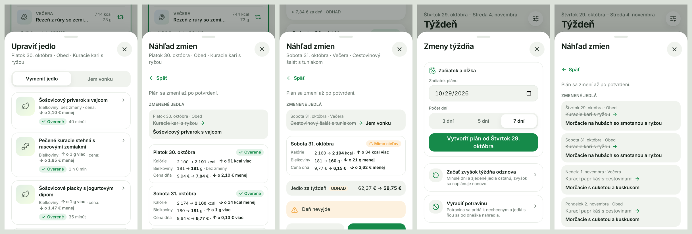
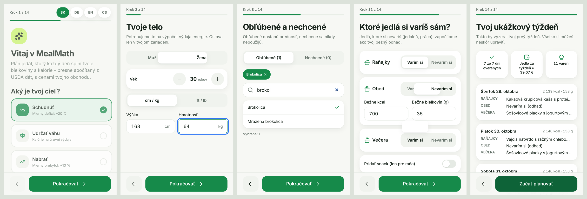
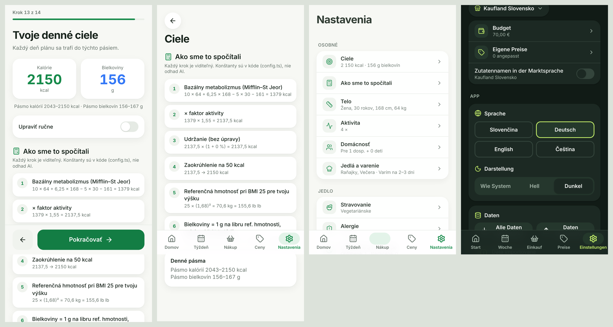

# MealMath

Offline-first PWA na plánovanie jedál podľa makier, rozpočtu a obchodu (Lidl DE, Lidl SK, Kaufland SK).
Bez účtov a bez predplatného, všetky dáta zostávajú v zariadení.

> Stav: **etapy 1 – 7 hotové** – dáta, vzorce, validátor, ceny a obchody, plánovač, celé UI (SK/DE, EN/CS pripravené, svetlý/tmavý režim), zmeny týždňa, PWA a offline.








## Hlavný princíp

Žiadne nutričné číslo nepochádza z jazykového modelu. Každé makro sa počíta ako
`gramy × hodnota na 100 g` zo záznamu **USDA FoodData Central** (verejná doména).
Recepty neobsahujú predpočítané makrá a test (`src/data/__tests__/data.test.ts`) to stráži.

## Spustenie

```bash
cd mealmath
npm install
npm run dev       # vývojový server (http://localhost:5173)
npm test          # Vitest: vzorce, validátor, plánovač, ceny, integrita dát
npm run build     # typecheck + produkčný build do dist/
```

## Inštalácia na iPhone

1. Otvor nasadenú adresu (napr. `https://<používateľ>.github.io/kamil-planovac/mealmath/`) v **Safari**.
2. Ťukni na **Zdieľať** → **Pridať na plochu**.
3. Appka sa spúšťa na celú obrazovku a po prvom otvorení funguje **úplne offline** – všetky súbory,
   dáta (USDA, recepty, ceny) aj plánovač sú uložené v zariadení. Tvoje dáta ostávajú v IndexedDB
   zariadenia a nikam sa neposielajú.

Keď vyjde nová verzia, appka ponúkne „Načítať“ – nikdy sa neobnoví sama uprostred práce.

## Nasadenie zadarmo

Appka je čisto statická (žiadny server, žiadne účty), stačí hosting statických súborov.

### GitHub Pages
1. V repozitári: **Settings → Pages → Source: GitHub Actions**.
2. Zmeny v `mealmath/` na vetve `main` spustia `.github/workflows/mealmath-pages.yml`
   (testy → build → nasadenie). Dá sa spustiť aj ručne v záložke **Actions**.
3. Adresa: `https://<používateľ>.github.io/<repozitár>/`. Build používa relatívne cesty (`base: './'`)
   a hash routing, takže funguje v podpriečinku bez ďalších nastavení.

### Cloudflare Pages
1. **Workers & Pages → Create → Pages → Connect to Git**, vyber repozitár.
2. Build command: `cd mealmath && npm ci && npm run build`
3. Build output directory: `mealmath/dist`
4. Environment variable `NODE_VERSION = 22`.

### Lokálne
```bash
cd mealmath && npm run build && npm run preview   # http://localhost:4173
```

## Dáta

| Súbor | Obsah |
|---|---|
| `scripts/food-list.txt` | ~370 surovín: ktorý USDA záznam, názvy EN/SK/DE, ulička, alergény, príznaky, trvanlivosť. **Bez čísel.** |
| `scripts/build-foods.ts` | Stiahne USDA SR Legacy + Foundation CSV a vytvorí `data/foods.json`. |
| `data/foods.json` | Vygenerované, nikdy needitovať ručne. |
| `data/foods-report.md` | Report párovania (presná / približná zhoda, fdcId, hodnoty). |
| `data/recipes/*.json` | 117 ručne písaných receptov (SK + DE), gramy s rozsahom min–max. |

### Aktualizácia `foods.json`

Automaticky: každý push, ktorý zmení `scripts/food-list.txt`, spustí GitHub Action
`.github/workflows/mealmath-build-foods.yml`. Tá stiahne USDA dáta a commitne `foods.json` a report.
Dá sa spustiť aj ručne cez *Actions → Run workflow*.

Lokálne: `npm run build:foods` (potrebuje prístup na `fdc.nal.usda.gov`).

Ak USDA záznam nesedí presne, skript skúsi približnú zhodu. Keď si nie je istý, zlyhá a vypíše
kandidátov do reportu. Konkrétny záznam sa dá pripnúť 11. stĺpcom (`fdcId`).

### Pridanie receptu

Pridaj objekt do príslušného súboru v `data/recipes/` (raňajky, hlavné jedlá, snacky):

- `ingredients`: `food` (id z food-list), `g` (bežná porcia), `min`/`max` (rozsah, v ktorom smie plánovač škálovať tvoju porciu; `min = max` znamená pevné množstvo, `min = 0` znamená voliteľný doplnok),
- `steps.sk` a `steps.de` s rovnakým počtom krokov,
- alergény a diéty sa **nepíšu**, odvodzujú sa zo surovín.

Potom spusti `npm run format:recipes` (zjednotí formát) a `npm test`.

## Plánovač

Deterministický, bez jazykového modelu (`src/engine/planner/`):

1. **Filter**: recept zostane len vtedy, ak všetky jeho potrebné suroviny prejdú alergénmi, diétou,
   nechcenými surovinami a dostupnosťou v obchode a ak máš potrebné vybavenie. Voliteľné suroviny
   (`min = 0`) sa namiesto toho nastavia na 0 g.
2. **Rozloženie týždňa**: greedy výber varení podľa hustoty bielkovín, ceny, obľúbených surovín a
   pestrosti. Batch recept nakŕmi ďalšie jedlá v rámci trvanlivosti. Miera opakovania 0 – 3 určuje,
   koľko porcií dá jeden hrniec.
3. **LP pre celý týždeň** (`javascript-lp-solver`): nastaví gramy mojej porcie tak, aby **každý deň**
   (nie priemer) mal bielkoviny v pásme floor až +7 % a kcal v pásme −5 % až 0 %. Porcie z jedného
   hrnca sú rovnaké. Čo sa nedá splniť, zachytia penalizované odchýlky, takže výsledok je vždy
   najlepší možný plán.
4. **Lokálne prehľadávanie** vymieňa recepty v dňoch, ktoré nevyšli (časový limit 1,5 s).
5. Gramy sa zaokrúhlia a **nezávislý validátor** plán prepočíta z `foods.json`. Ak deň nesedí, plán
   vráti upozornenie „X dní nesplnených o Y g“, nikdy tichý úspech.

### Zmeny týždňa (`src/engine/changes.ts`)

Každá zmena najprv vráti **náhľad** (rozdiel kcal, bielkovín a ceny po dňoch, zmenené jedlá) a plán sa uloží až po potvrdení.

- **Vymeniť jedlo**: 6 návrhov, každý s vlastným náhľadom. Ostatné nezjedené jedlá dňa ostanú a len sa preškálujú. Ak to nestačí, smú sa zmeniť aj porcie zdieľaného hrnca (a skontrolujú sa všetky dni, ktoré kŕmi).
- **Jem vonku**: tvoj odhad kcal/bielkovín sa započíta a zvyšok dňa sa prepočíta. Ak deň nevyjde, náhľad to povie.
- **Začať zvyšok týždňa odznova / Vyradiť potravinu / výmena po prepnutí obchodu**: minulé dni a zjedené jedlá ostanú zamknuté, plánovač doplní iba otvorené pozície.
- **Začiatok a dĺžka plánu** (3/5/7 dní) – nový plán okamžite.

Rozpočet je mäkké obmedzenie: plánovač ho nikdy nevymení za nesplnené bielkoviny, prekročenie ohlási.
Konštanty sú v `src/engine/config.ts` (`CONFIG_PLANNER`).

## Onboarding a nastavenia

14 krokov: cieľ, telo (cm/kg aj ft/lb), aktivita, obchod, rozpočet, diéta, 12 alergénov, obľúbené/nechcené suroviny,
vybavenie, domácnosť, ktoré jedlá si varíš (jedlá mimo domu sa rátajú ako tvoj bežný odhad), miera opakovania,
vypočítané ciele (s možnosťou ručnej úpravy a celým výpočtom „Ako sme to spočítali“) a ukážkový týždeň.
Nastavenia používajú tie isté kroky. Zmena, ktorá ovplyvní plán, ho označí ako zastaraný a ponúkne nový týždeň.
**Export/import všetkých dát** (nastavenia, plány, vlastné ceny, záznam váhy) je jeden JSON súbor. API kľúč a PIN v ňom nie sú. Na Domov sa po týždni bez zálohy ukáže pripomienka.
Ukladá sa aktuálny plán + 4 posledné staršie; staršie sa pri novom pláne automaticky zmažú (`prunePlans`).

### Pokrok, PIN a ďalšie obchody (verzia 1.2)

- **Pokrok a náklady** (`#/progress`): záznam váhy s grafom, trendom a posúdením tempa voči cieľu (`src/engine/progress.ts`),
  možnosť prepísať váhu v profile; zoznam nákladov na jedlo za uložené plány.
- **Zámok PIN** (Nastavenia → Aplikácia): 4 alebo 6 číslic, uložený len ako soľou posolený PBKDF2 hash (`src/state/pin.ts`).
  Aplikácia sa zamkne pri štarte a po 30 s na pozadí; po 5 chybách sa čaká 30 s a viac. Zámok skrýva aplikáciu pred cudzou osobou
  s odomknutým telefónom, údaje v IndexedDB **nešifruje**. Zabudnutý PIN = zmazať údaje (záloha ostáva).
- **Obchody**: pribudli Billa SK, Tesco SK a Aldi Süd DE (odhady ako ostatné). `npm run seed:prices` už existujúce súbory neprepíše (`-- --force` ich prepíše).
- **Čeština** je kompletná; test `src/i18n/__tests__` stráži, aby mal každý jazyk všetky kľúče aj rovnaké `{{premenné}}`.
- **Prístupnosť**: `npm run check:a11y` (axe-core, WCAG A/AA) prejde všetky obrazovky vo svetlom aj tmavom režime. Farby `--c-primary`, `--c-text-2` a `--c-warning`
  sú oproti pôvodnému zadaniu mierne stmavené, aby spĺňali kontrast 4,5 : 1.

### Návrhy receptov cez Claude (voliteľné, predvolene vypnuté)

Nastavenia → Jedlo → *Návrhy receptov (Claude)*. Používateľ zadá vlastný Anthropic API kľúč (uložený len v zariadení,
nie je v zálohe). Model `claude-opus-5-5` dostane iba zoznam **povolených** potravín (diéta, alergény, nechcené, dostupné
v obchode) a prianie; cez structured outputs vráti JSON bez akýchkoľvek nutričných polí (`src/engine/aiRecipe.ts`).
Kód potom: overí id potravín voči `foods.json` a gramáže (`parseAiRecipe`), znova skontroluje obmedzenia
(`constraintViolations` v `src/state/ai.ts`) a makrá vypočíta z USDA. Neplatný návrh sa zamietne, nikdy „neopraví“.
Uložené recepty (`settings.customRecipes`, id `ai-…`) sa pridajú ku katalógu (`registerCustomRecipes`) a plánovač
ich používa ako ostatné. Recept v aktuálnom pláne sa nedá zmazať. SDK sa načíta až pri prvom návrhu.

## Obchody a ceny

> **Všetky ceny sú ODHADY.** Ide o ručne odhadnuté bežné ceny regálov (jeseň 2026), nie živé ceny.
> Weby obchodov sa nescrapujú a appka za behu nič nesťahuje. Uprav si ich v appke na obrazovke **Ceny**.

| Súbor | Obchod | Jazyk názvov |
|---|---|---|
| `prices/lidl-de.json` | Lidl Deutschland | DE |
| `prices/lidl-sk.json` | Lidl Slovensko | SK |
| `prices/kaufland-sk.json` | Kaufland Slovensko | SK |

Každá položka je buď `{ "name", "packG", "price", "updated" }`, alebo `{ "unavailable": true, "substitute"?: "<foodId>" }`.
Plánovač nepoužije nedostupnú surovinu. Pri prepnutí obchodu sa plán neprepíše, appka ponúkne výmenu jedla.

**Aktualizácia cien:**
- v appke: obrazovka *Ceny* → upraviť. Úprava sa uloží lokálne a má prednosť pred tabuľkou.
- hromadne: *Ceny → Export JSON*, upraviť v editore, *Import JSON*.
- v repozitári: upraviť priamo `prices/<obchod>.json` (a dátum `updated`), potom `npm test`.

`scripts/price-seed.txt` a `npm run seed:prices` slúžili len na prvé naplnenie tabuliek. **Opätovné spustenie ich prepíše.**

**Pridanie nového obchodu (napr. Kaufland DE):**
1. Skopíruj napr. `prices/lidl-de.json` do `prices/kaufland-de.json`.
2. Zmeň `store` (`id` = názov súboru, `name`, `chain`, `country`, `lang`, voliteľne `aisleOrder`).
3. Uprav ceny, balenia a dostupnosť. Každá surovina z `foods.json` musí byť uvedená.
4. `npm test`. Appka obchod nájde automaticky, nič iné netreba.

Nákupný zoznam zaokrúhľuje na celé balenia a ukazuje dve sumy: **jedlo tento týždeň** (pomerná cena
toho, čo zješ, porovnaná s rozpočtom) a **spolu na pokladni** (celé balenia). Základné zásoby (soľ,
korenie, olej, múka, cukor…) sú oddelené a do pokladne sa štandardne nerátajú.

## UI a architektúra

```
mealmath/
  data/foods.json, data/recipes/*.json   ← USDA hodnoty (generované) a recepty
  prices/<obchod>.json                   ← cenové tabuľky (ODHADY), automaticky načítané
  scripts/                               ← build-foods (USDA), seed-prices, format-recipes
  src/engine/                            ← čistý TypeScript: vzorce, validátor, plánovač, ceny, zmeny
  src/data/                              ← načítanie dát a register obchodov
  src/state/                             ← Dexie (IndexedDB), záloha, service worker
  src/workers/                           ← plánovač vo Web Workeri (UI nezamŕza)
  src/ui/                                ← tokeny, komponenty, obrazovky, onboarding
  src/i18n/                              ← sk, de, en, cs
```

- `src/ui/tokens.css` – dizajnové tokeny (farby ako sémantické CSS premenné, svetlý/tmavý režim, typografia, radiusy). Komponenty nikdy nepoužívajú priame farby.
- `src/ui/components/` – zdieľané komponenty (AppShell, BottomNavigation, StoreSelector, MacroRing, MealCard, WeeklyDayStrip, BottomSheet, …).
- `src/i18n/` – texty SK, DE (hlavné), EN, CS. V komponentoch nie je žiadny napevno napísaný text.
- Plánovač beží vo Web Workeri (`src/workers/`), dáta sú v IndexedDB (Dexie, `src/state/`).
- Fotky jedál: generované ilustrácie, alebo vlastné fotky z `src/photos/<recipeId>.webp`.

## Testy

```bash
npm test          # ~600 testov (Vitest)
```
- vzorce cieľov (Mifflin–St Jeor, aktivita, cieľ, bielkoviny, zaokrúhlenie),
- nezávislý validátor (pásma, alergény, diéty, dostupnosť, rozsahy gramov, low-carb),
- integrita dát (každá surovina z USDA, energia sedí s Atwaterom, recepty bez makier),
- ceny a prepočet pri zmene obchodu (balenia, zvyšky, overrides, export/import),
- plánovač na skutočných dátach (všetky obchody, diéty, alergie, rodina, rozpočet, determinizmus),
- zmeny týždňa (náhľad nemení plán, výmena, jem vonku, vyradenie potraviny, konflikty obchodu).

CI (`.github/workflows/mealmath-ci.yml`) spúšťa testy a build pri každej zmene.

## Obmedzenia

- Výrobky v obchodoch sa líšia od USDA záznamov (napr. skyr je mapovaný na grécky jogurt 0 %, bryndza na fetu). Použitý USDA záznam sa vždy zobrazí v „Ako sme to spočítali“.
- Alergény sú orientačné, vždy skontroluj etiketu výrobku.
- Ceny (etapa 2) sú **odhady**, nie živé ceny obchodov.
- Fotky jedál sú zatiaľ generované ilustrácie. Vlastnú fotku pridáš ako `src/photos/<recipeId>.webp` (napr. `src/photos/bryndza-halusky.webp`) – pri builde sa nájde sama a uloží aj pre offline.
- Návrhy receptov cez Claude potrebujú internet a vlastný platený API kľúč.
