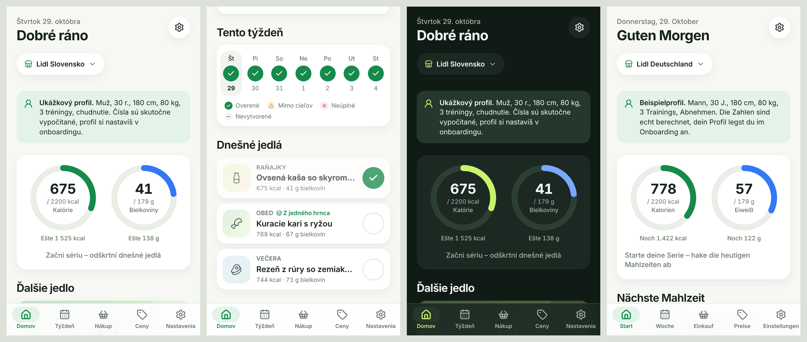
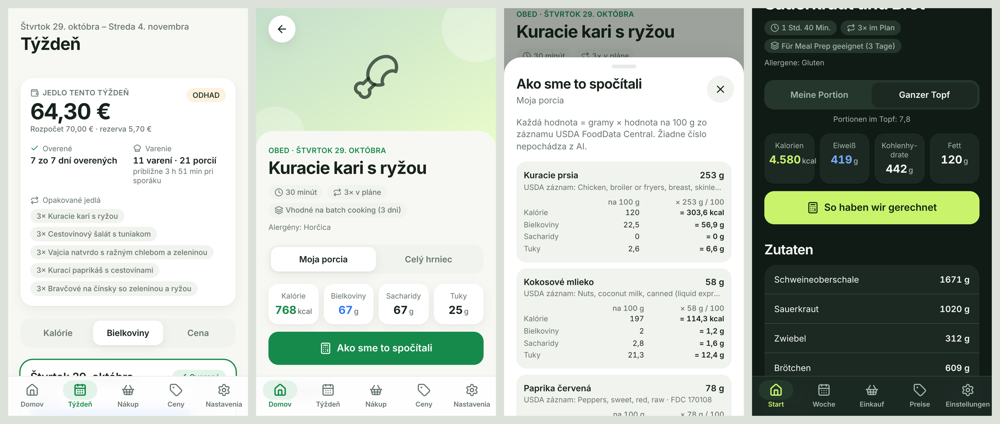
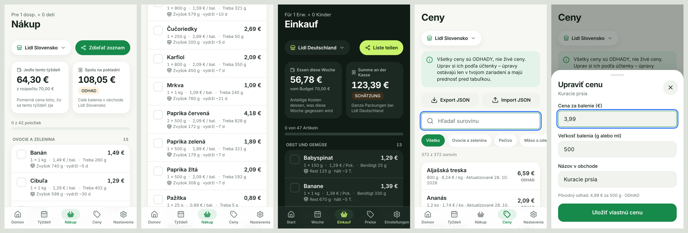

# MealMath

Offline-first PWA na plánovanie jedál podľa makier, rozpočtu a obchodu (Lidl DE, Lidl SK, Kaufland SK).
Bez účtov a bez predplatného, všetky dáta zostávajú v zariadení.

> Stav: **etapa 5** – engine + obrazovky Domov, Týždeň, Recept (s „Ako sme to spočítali“), Nákup a Ceny. Zmeny týždňa, onboarding, nastavenia a PWA prídu v ďalších etapách.







## Hlavný princíp

Žiadne nutričné číslo nepochádza z jazykového modelu. Každé makro sa počíta ako
`gramy × hodnota na 100 g` zo záznamu **USDA FoodData Central** (verejná doména).
Recepty neobsahujú predpočítané makrá a test (`src/data/__tests__/data.test.ts`) to stráži.

## Spustenie

```bash
cd mealmath
npm install
npm run dev       # vývojový server (http://localhost:5173)
npm test          # Vitest: vzorce, validátor, plánovač, ceny, integrita dát
npm run build     # typecheck + produkčný build do dist/
```

## Dáta

| Súbor | Obsah |
|---|---|
| `scripts/food-list.txt` | ~370 surovín: ktorý USDA záznam, názvy EN/SK/DE, ulička, alergény, príznaky, trvanlivosť. **Bez čísel.** |
| `scripts/build-foods.ts` | Stiahne USDA SR Legacy + Foundation CSV a vytvorí `data/foods.json`. |
| `data/foods.json` | Vygenerované, nikdy needitovať ručne. |
| `data/foods-report.md` | Report párovania (presná / približná zhoda, fdcId, hodnoty). |
| `data/recipes/*.json` | 117 ručne písaných receptov (SK + DE), gramy s rozsahom min–max. |

### Aktualizácia `foods.json`

Automaticky: každý push, ktorý zmení `scripts/food-list.txt`, spustí GitHub Action
`.github/workflows/mealmath-build-foods.yml`. Tá stiahne USDA dáta a commitne `foods.json` a report.
Dá sa spustiť aj ručne cez *Actions → Run workflow*.

Lokálne: `npm run build:foods` (potrebuje prístup na `fdc.nal.usda.gov`).

Ak USDA záznam nesedí presne, skript skúsi približnú zhodu. Keď si nie je istý, zlyhá a vypíše
kandidátov do reportu. Konkrétny záznam sa dá pripnúť 11. stĺpcom (`fdcId`).

### Pridanie receptu

Pridaj objekt do príslušného súboru v `data/recipes/` (raňajky, hlavné jedlá, snacky):

- `ingredients`: `food` (id z food-list), `g` (bežná porcia), `min`/`max` (rozsah, v ktorom smie plánovač škálovať tvoju porciu; `min = max` znamená pevné množstvo, `min = 0` znamená voliteľný doplnok),
- `steps.sk` a `steps.de` s rovnakým počtom krokov,
- alergény a diéty sa **nepíšu**, odvodzujú sa zo surovín.

Potom spusti `npm run format:recipes` (zjednotí formát) a `npm test`.

## Plánovač

Deterministický, bez jazykového modelu (`src/engine/planner/`):

1. **Filter**: recept zostane len vtedy, ak všetky jeho potrebné suroviny prejdú alergénmi, diétou,
   nechcenými surovinami a dostupnosťou v obchode a ak máš potrebné vybavenie. Voliteľné suroviny
   (`min = 0`) sa namiesto toho nastavia na 0 g.
2. **Rozloženie týždňa**: greedy výber varení podľa hustoty bielkovín, ceny, obľúbených surovín a
   pestrosti. Batch recept nakŕmi ďalšie jedlá v rámci trvanlivosti. Miera opakovania 0 – 3 určuje,
   koľko porcií dá jeden hrniec.
3. **LP pre celý týždeň** (`javascript-lp-solver`): nastaví gramy mojej porcie tak, aby **každý deň**
   (nie priemer) mal bielkoviny v pásme floor až +7 % a kcal v pásme −5 % až 0 %. Porcie z jedného
   hrnca sú rovnaké. Čo sa nedá splniť, zachytia penalizované odchýlky, takže výsledok je vždy
   najlepší možný plán.
4. **Lokálne prehľadávanie** vymieňa recepty v dňoch, ktoré nevyšli (časový limit 1,5 s).
5. Gramy sa zaokrúhlia a **nezávislý validátor** plán prepočíta z `foods.json`. Ak deň nesedí, plán
   vráti upozornenie „X dní nesplnených o Y g“, nikdy tichý úspech.

Rozpočet je mäkké obmedzenie: plánovač ho nikdy nevymení za nesplnené bielkoviny, prekročenie ohlási.
Konštanty sú v `src/engine/config.ts` (`CONFIG_PLANNER`).

## Obchody a ceny

> **Všetky ceny sú ODHADY.** Ide o ručne odhadnuté bežné ceny regálov (jeseň 2026), nie živé ceny.
> Weby obchodov sa nescrapujú a appka za behu nič nesťahuje. Uprav si ich v appke na obrazovke **Ceny**.

| Súbor | Obchod | Jazyk názvov |
|---|---|---|
| `prices/lidl-de.json` | Lidl Deutschland | DE |
| `prices/lidl-sk.json` | Lidl Slovensko | SK |
| `prices/kaufland-sk.json` | Kaufland Slovensko | SK |

Každá položka je buď `{ "name", "packG", "price", "updated" }`, alebo `{ "unavailable": true, "substitute"?: "<foodId>" }`.
Plánovač nepoužije nedostupnú surovinu. Pri prepnutí obchodu sa plán neprepíše, appka ponúkne výmenu jedla.

**Aktualizácia cien:**
- v appke: obrazovka *Ceny* → upraviť. Úprava sa uloží lokálne a má prednosť pred tabuľkou.
- hromadne: *Ceny → Export JSON*, upraviť v editore, *Import JSON*.
- v repozitári: upraviť priamo `prices/<obchod>.json` (a dátum `updated`), potom `npm test`.

`scripts/price-seed.txt` a `npm run seed:prices` slúžili len na prvé naplnenie tabuliek. **Opätovné spustenie ich prepíše.**

**Pridanie nového obchodu (napr. Kaufland DE):**
1. Skopíruj napr. `prices/lidl-de.json` do `prices/kaufland-de.json`.
2. Zmeň `store` (`id` = názov súboru, `name`, `chain`, `country`, `lang`, voliteľne `aisleOrder`).
3. Uprav ceny, balenia a dostupnosť. Každá surovina z `foods.json` musí byť uvedená.
4. `npm test`. Appka obchod nájde automaticky, nič iné netreba.

Nákupný zoznam zaokrúhľuje na celé balenia a ukazuje dve sumy: **jedlo tento týždeň** (pomerná cena
toho, čo zješ, porovnaná s rozpočtom) a **spolu na pokladni** (celé balenia). Základné zásoby (soľ,
korenie, olej, múka, cukor…) sú oddelené a do pokladne sa štandardne nerátajú.

## UI

- `src/ui/tokens.css` – dizajnové tokeny (farby ako sémantické CSS premenné, svetlý/tmavý režim, typografia, radiusy). Komponenty nikdy nepoužívajú priame farby.
- `src/ui/components/` – zdieľané komponenty (AppShell, BottomNavigation, StoreSelector, MacroRing, MealCard, WeeklyDayStrip, BottomSheet, …).
- `src/i18n/` – texty SK, DE (hlavné), EN, CS. V komponentoch nie je žiadny napevno napísaný text.
- Plánovač beží vo Web Workeri (`src/workers/`), dáta sú v IndexedDB (Dexie, `src/state/`).
- Fotky jedál: zatiaľ generované ilustrácie. Vlastné fotky sa dajú doplniť ako `public/photos/<recipeId>.webp` (zapojenie v neskoršej etape).

## Obmedzenia

- Výrobky v obchodoch sa líšia od USDA záznamov (napr. skyr je mapovaný na grécky jogurt 0 %, bryndza na fetu). Použitý USDA záznam sa vždy zobrazí v „Ako sme to spočítali“.
- Alergény sú orientačné, vždy skontroluj etiketu výrobku.
- Ceny (etapa 2) sú **odhady**, nie živé ceny obchodov.
